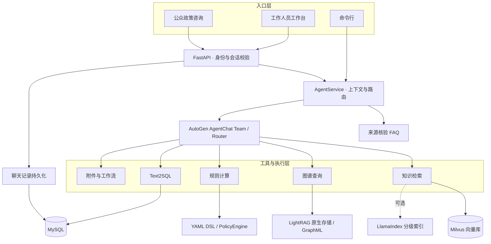

  <h1> Glyph</h1>

  

    <strong>政务政策智能问答与补贴测算平台</strong> 
    基于 AutoGen 多智能体编排，融合政策检索、知识图谱、规则计算与结构化查询
  

  

    
    
    
    
    
    
    
  

  

    <a href="#项目简介">项目简介</a> ·
    <a href="#核心功能">核心功能</a> ·
    <a href="#技术架构">技术架构</a> ·
    <a href="#核心执行流程">执行流程</a>
  

## 项目简介

政务政策服务同时涉及政策原文、办事指南、适用地区、执行期限与金额规则。同一个问题可能需要查找条款、补充个人条件、核对政策版本，再完成补贴计算。政策检索、条件判断与金额计算因此需要共享来源和业务条件，让回答与计算依据保持一致。

**Glyph** 面向政策咨询、资格判断、办理流程和补贴测算，将 **AutoGen 多智能体编排、Milvus 向量检索、LightRAG 图谱查询、YAML DSL 规则引擎和 Text2SQL** 集成到统一服务中。模型负责理解问题、提取条件与选择工具，规则引擎和数据库负责计算及查询，回答结合来源与执行结果呈现。

系统提供公众咨询与工作人员工作台。公众可以询问政策、补充条件并查看测算依据；工作人员可以管理知识资料、核对解析正文、探索政策关系、编辑规则草稿和查询结构化数据。当前资料以常州、江苏和全国适用政策为主要服务范围。

### 核心价值

- **从问答到计算**：将政策解释、条件澄清和确定性测算连接起来，覆盖“能否申请、能补多少、如何办理”的咨询过程。
- **多种依据协同**：按任务调用原文检索、政策关系、金额规则或结构化数据库，让不同问题使用对应的执行能力。
- **结果可以复核**：保存政策来源、引用条款、规则适用期及核验记录，展示计算明细与需要人工确认的条件。
- **知识可以维护**：通过原文、解析缓存、处理配置、预览和入库状态管理政策资料，避免上传后无法核对处理结果。
- **入口权限分明**：公众咨询与工作人员管理使用不同访问凭证，数据库查询和私有档案能力由服务端控制。

## 核心功能

| 功能模块 | 说明 | 技术实现 |
| --- | --- | --- |
| **智能问答与工具编排** | 理解问题并调用知识、图谱、规则、SQL 或工作流工具 | AutoGen AgentChat Team / Router + AgentService |
| **政策知识检索** | 检索政策原文，支持可选分级索引与重排 | Milvus + LlamaIndex + Reranker |
| **来源核验 FAQ** | 对已核验问句快速作答，检查来源、地区和适用日期 | 严格问句匹配 + 正文哈希与引文核验 |
| **补贴与资格测算** | 提取明确条件，执行比例、额度、封顶和资格计算 | YAML DSL + PolicyEngine + 领域计算函数 |
| **规则生成与试算** | 从政策材料生成草稿，编辑、保存并检查试算结果 | DSL 生成管线 + 草稿试算 + 规则核验记录 |
| **知识库工作区** | 上传、重新解析、原文与 PDF 页图查看、切块预览、显式入库 | 版本化解析缓存 + DocumentWorkspace |
| **政策图谱探索** | 搜索实体、展开关系邻居、查看有限子图与统计 | LightRAG / GraphML + AntV G6 |
| **结构化查询** | 工作人员使用自然语言查询业务数据 | ChatDB / Text2SQL + 只读 SQL 校验 + MySQL |
| **附件与多模态** | 结合用户附件处理问题，按配置启用图片识别 | WorkflowAgent + 文档解析 + 可选 Vision 模型 |
| **会话与访问控制** | 保存聊天记录，隔离公众与工作人员会话 | MySQL + 签名会话凭证 + HttpOnly Cookie / CSRF |

## 技术架构

系统按职责分为入口、编排、执行和数据四层：

| 层级 | 职责 | 主要组件 |
| --- | --- | --- |
| **入口层** | 承接公众咨询、工作人员管理、会话与流式响应 | Vue 3、FastAPI、AG-UI / SSE、CLI |
| **编排层** | 管理问题上下文，处理 FAQ，选择工具与回退路径 | AgentService、AutoGen AgentChat Team / Router |
| **执行层** | 执行知识检索、图谱查询、规则计算、SQL 与附件工作流 | KnowledgeAgent、GraphAgent、RuleEngineAgent、ChatDB、WorkflowAgent |
| **数据层** | 保存政策资料、向量、图关系、业务数据与规则 | Milvus、LightRAG、MySQL、政策原文、YAML 规则 |

图谱查询使用 LightRAG，关系探索页面读取其 GraphML 文件；当前默认图谱链路不依赖 Neo4j 作为主存储。MySQL 负责业务数据、连接元数据和聊天记录，模型上下文由进程内 AutoGen 记忆维护。

## 核心执行流程

### 1. 问题接收与快速响应

服务先校验入口身份与会话，恢复本轮所需上下文。普通问答优先处理问候与已核验 FAQ；FAQ 未命中时继续进入模型与工具编排。

FAQ 使用严格问句匹配，同时核对来源正文、引文、地区和适用日期，避免把条件相反或适用地区不同的问题当作同一问句。

### 2. 智能体编排与专项路由

普通请求按配置优先尝试 **AgentChat Team**，随后在允许回退时尝试 **Router**；允许回退且两者未得到结果时进入知识问答。附件和强制 Text2SQL 等请求经过改写、快速路由或意图判断，交给相应专项流程。

| 工具 | 执行职责 |
| --- | --- |
| `knowledge_tool` | 检索政策资料并组织基于原文的回答 |
| `graph_tool` | 查询政策实体与关系，补充关联信息 |
| `rule_tool` | 匹配规则，提取条件并执行补贴或资格计算 |
| `text2sql_tool` | 在工作人员权限下查询结构化业务数据 |
| `workflow_tool` | 结合附件和已启用的视觉等能力处理问题 |

### 3. 执行结果与来源返回

问答界面通过 **AG-UI** 接收运行、处理阶段、工具调用与正文事件，显示真实进度，支持停止和失败后手动重试。协议由 SSE 传输，模型正文能否逐步返回仍由流式配置、请求类型及模型能力共同决定；最终答复快照替换草稿，避免重复拼接。

正文中的资料编号可点击查看对应依据；同一政策的多处引用合并展示，保留各自编号与摘录。有可用原文链接时可直接打开，条款在返回摘录中出现时会定位高亮。

普通问答、附件与模型流式路径的具体分支见[技术栈与回答链路](./docs/TECH_STACK_OVERVIEW.md)。

## 项目特色

### 规则计算与模型生成分工

模型负责理解意图、选择规则和提取用户明确提供的条件；金额与资格逻辑由 `PolicyEngine` 及领域函数执行。当前规则覆盖 2026 年全国家电、数码、汽车以旧换新，以及常州住房、公积金、人才、育儿等场景。

规则核验记录绑定 YAML、政策来源和计算实现的指纹，版本变化后需要重新核验。草稿生成与试算不能代替政策核验，部分场景保留人工确认入口。[规则范围与限制](./resources/data/policy_catalog/RULES_2026.md)

### 原文检索与政策关系互补

**Milvus** 提供原文语义检索，**LlamaIndex** 可选融合预先构建的分级索引，**LightRAG** 支撑图谱查询。知识检索按文档 ID 合并结果；图谱结果为空时可返回知识问答路径。重排和联网搜索按配置启用。

### 文档处理过程可查看

知识库保留原文、版本化解析结果和处理配置，支持 PDF 页图、Markdown 正文、句子边界或固定长度切块预览。原文与解析版本会在入库前核对，减少使用过期解析结果的风险。

预览与索引写入分别管理：当前网页按整篇解析正文入库，切块预览不直接驱动逐块写入；常州专项导入另有分段、稳定 ID 和读回核验流程。分级索引、图谱构建及工作区能力边界见[技术说明](./docs/TECH_STACK_OVERVIEW.md#文档工作区与索引)。

### 公众服务与工作人员管理分离

公众可以咨询政策、使用测算与图谱工具；知识库管理、规则维护、数据库查询和私有档案访问需要工作人员权限。会话凭证、Cookie、CSRF 校验与账号命名空间共同约束服务端访问。

聊天记录持久化与模型记忆分别管理：前者写入 MySQL，后者使用进程内 `ListMemory` 和 `BufferedChatCompletionContext`。当前记忆桥接器没有实现 Redis 持久化。[认证与会话说明](./docs/AUTHENTICATION.md)

## 技术栈

| 方向 | 技术 |
| --- | --- |
| **后端服务** | Python 3.10、FastAPI、Uvicorn、Pydantic v2、pydantic-settings |
| **智能体与模型** | AutoGen Core / AgentChat、OpenAI 兼容模型接口 |
| **检索与图谱** | Milvus、LlamaIndex、LightRAG、可选 Reranker |
| **规则与查询** | YAML DSL、PolicyEngine、ChatDB / Text2SQL |
| **数据持久化** | MySQL、SQLAlchemy、PyMySQL |
| **文档与多模态** | LlamaIndex、PyMuPDF、TXT / Markdown 读取、可选 MinerU 与 Vision 服务 |
| **前端界面** | Vue 3、Vite、Vue Router、Pinia、Element Plus、AntV G6 |
| **工程与验证** | Docker Compose、pytest、Ruff、mypy、Vue 静态编译与生产构建 |

## 数据来源与许可

当前资料包括常州、江苏和全国适用的正式政策、官方解读、办事指南、公开问答，以及明确标注来源的用户语料和保险产品资料。来源性质、正文快照、引文与适用范围分别记录，不将所有材料统一视为政府正式文件。

测算结果用于辅助理解政策，实际办理以对应年度、地区的有效政策及受理机关要求为准。项目代码采用 [MIT License](./LICENSE)，第三方资料与依赖遵循各自许可和使用条件。

## 致谢

- [AutoGen](https://github.com/microsoft/autogen) · 智能体与工具编排
- [FastAPI](https://fastapi.tiangolo.com/) · API 服务
- [Milvus](https://milvus.io/) · 向量存储与检索
- [LlamaIndex](https://github.com/run-llama/llama_index) · 文档解析与索引
- [LightRAG](https://github.com/HKUDS/LightRAG) · 图谱检索增强
- [Vue](https://vuejs.org/) · 前端界面
- [AntV G6](https://g6.antv.antgroup.com/) · 图谱可视化
